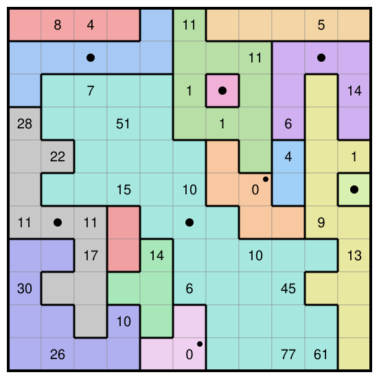

This is my solution to the October 2026 Jane Street puzzle, It's a Metric, Too, which is in the [Jane Street puzzle archive](https://www.janestreet.com/puzzles/archive/).
The answer is **408,951**.



## The puzzle

An 11 by 11 grid has to be cut into states.
A state is a connected set of squares that has at least one rotation or reflection symmetry.
If every symmetry of a state fixes exactly one of its squares, that square is the capitol of the state.
A step between two adjacent squares costs the size of the state, or the smaller of the two sizes when the squares lie in different states.
A number in a square is the cost of the cheapest path from that square to any capitol.
To get the answer, write the size of its state into every square, add up each row, and sum the squares of the eleven row sums.

## Notation

We index squares by (row, column) from the top left, starting at 0.
For a square $v$, let $s(v)$ be the size of its state and $d(v)$ the cost of the cheapest path from $v$ to a capitol.
A step between adjacent squares $u$ and $v$ costs $w(u,v)=\min(s(u),s(v))$, so $d$ is the distance to the nearest capitol in a weighted grid graph, and the clues fix $d$ on 33 squares.

## Two observations

Most of the hand reasoning uses two facts.

The first is a Lipschitz bound.
If $u$ and $v$ are adjacent, then $|d(u)-d(v)|\le w(u,v)\le\min(s(u),s(v))$.
So two neighbouring clues that differ by $k$ force both of their states to have size at least $k$.
For example, the 77 and the 61 in the bottom row put both squares in states of size at least 16.

The second concerns steps of cost 1.
A step costs 1 only if one of its two squares is a singleton.
A singleton is fixed by every symmetry and has only one square, so every singleton is a capitol.
Hence a square with clue 1 is not a singleton and has a singleton neighbour, and a square with a clue of 2 or more has no singleton neighbour at all.

## The right edge

The 1 at (4,10) needs a singleton neighbour, and the candidates are (3,10), (4,9) and (5,10).
If (4,9) were a singleton, the 4 at (4,8) would be at most 1.
If (3,10) were a singleton, the 14 at (2,10) would be at most 1.
So (5,10) is a singleton capitol, and $d(6,10)=1$.

The 13 at (7,10) is adjacent to (6,10), so the first observation gives $\min(s(6,10),s(7,10))\ge 12$.
In the solution this is a single state of size 12 running down the right edge.
Its distances grow by 12 per step away from the singleton, and they are 13, 25, 37, 49 and 61 down column 10 and along to (10,9), of which 13 and 61 are clues.
The 45 at (8,8) is one more step of 12 from (8,9), whose distance is 33.

## The big state

The other large clues come from a single state of size 37.
It is symmetric under a rotation by 180 degrees about (6,5), and (6,5) is its capitol.
Each large clue is then a short chain.

* $51=7+7+37$ along (1,2), (1,3), (2,3), (3,3). The square (1,2) is the capitol of a state of size 7, and the last step is inside the big state.
* $77=3+37+37$ along (10,5), (10,6), (10,7), (10,8). The capitol (10,5) belongs to a state of size 3, and the last two steps are inside the big state.
* $22=11+11$ along (6,1), (5,1), (4,1), where (6,1) is the capitol of a state of size 11.

These chains explain the large numbers, but they do not pin down the partition.
I could not push the hand reasoning much further than this, so the rest was done by computer.

## Finding the partition

My first attempt was an exact search in C++, which is in [`cpp-search/`](https://github.com/que-ravon/jane-street-puzzles/tree/main/2026-10-its-a-metric-too/cpp-search).
It builds the partition one state at a time, fixes the size of a state when it creates it, and prunes with lower and upper bounds on $d$ at every square.
It is fast on small grids and agreed with brute force on a few hundred random test puzzles, but it never finished the 11 by 11.
The trouble is that it enumerates the shapes of one large state long before anything around it is placed, and nothing can rule those shapes out until much later.

The solution came from a CP-SAT model, [`solve.py`](https://github.com/que-ravon/jane-street-puzzles/blob/main/2026-10-its-a-metric-too/solve.py).
The model is built in four steps.
First, every square $v$ gets a variable $\mathrm{root}(v)$, the smallest index in its state, and connectivity is enforced with a depth labelling.
In a second step, every square carries a symmetry label $t$ that is constant on its state, and $t(v)$ must lie in the same state as $v$.
One label per state is enough, because a state with a 90 degree symmetry also has a 180 degree one.
In a third step, the capitol of a state is the unique square fixed by its label, when there is exactly one.
In a final step, $d$ is pinned down by $d(v)\le d(u)+w(u,v)$ on every edge, together with the condition that every square other than a capitol attains equality at some neighbour.

A state can have a second symmetry that fixes more than one square.
Such a state has no capitol, even though its label alone would give it one.
The model cannot see this, so after each solve I test every state against all eight symmetries of the square and add a constraint for any state whose capitol is wrong.
Before running the model on the real grid, I compared it with brute force on random 3 by 3 and 4 by 4 puzzles, which caught a bug in exactly this step.
With state sizes capped at 40, the model finds the solution in about 25 minutes on 8 cores.
It stops at the first solution, so the uniqueness of the answer rests on the puzzle.

## Checking

[`verify.py`](https://github.com/que-ravon/jane-street-puzzles/blob/main/2026-10-its-a-metric-too/verify.py) checks the answer and shares no code with the solver.
It tests every state for connectivity and symmetry, finds the capitols, runs Dijkstra from all capitols at once, and compares the distances with the 33 clues.

```
$ python3 verify.py
...
row sums: [58, 86, 202, 215, 211, 221, 180, 234, 212, 208, 206]
answer: 408951
all checks pass
```

## Files

* `puzzle.txt` has the clues and `solution.txt` has the partition, one letter per state.
* `solve.py` is the CP-SAT model. It needs `pip3 install ortools`.
* `verify.py` is the independent check, and `draw.py` draws `grid.svg`.
* `cpp-search/` has the C++ search and its input files.
